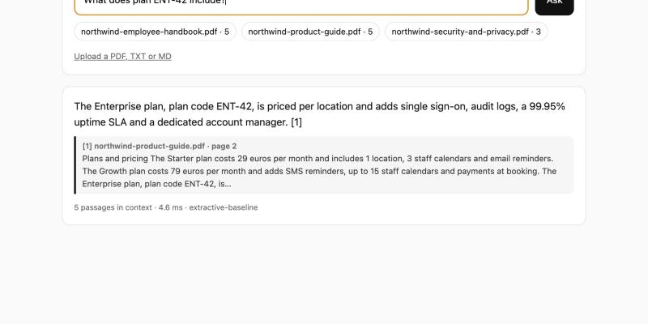
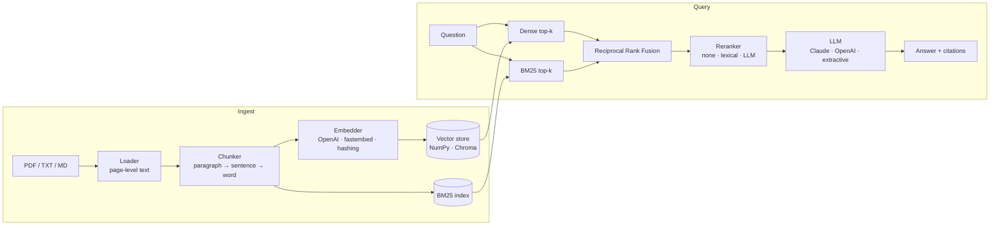

# rag-docs-assistant

[](https://github.com/joaofrancowork/rag-docs-assistant/actions/workflows/ci.yml)


Ask questions about your PDFs and get short answers that **cite the exact page**, or an honest
"I don't know". Hybrid retrieval (dense + BM25), a reranking stage, **Claude and OpenAI
interchangeable through config**, and an **evaluation harness** that measures every change.



## Quick start

```bash
git clone https://github.com/joaofrancowork/rag-docs-assistant && cd rag-docs-assistant
cp .env.example .env   # add ANTHROPIC_API_KEY, or set RAG_LLM_PROVIDER=extractive to run with no key
docker compose up --build   # then open http://localhost:8000 and upload a PDF
```

Without Docker: `uv sync --extra local`, then `uv run rag-docs ingest data/samples` and
`uv run rag-docs serve`.

## Architecture



| Layer | Implementation | Why |
|---|---|---|
| Chunking | Recursive split on paragraph, sentence, then word boundaries, with overlap; never crosses a page | Citations always point to one page |
| Retrieval | Dense + BM25 fused with RRF | Dense handles paraphrases, BM25 handles codes and names (`ENT-42`); RRF needs no score calibration |
| Reranking | Pluggable: lexical coverage or listwise LLM scoring | Cheap recall first, precise ordering second; the LLM reranker falls back safely on bad output |
| Generation | One `LLMClient` protocol (`complete(system, prompt)`) | Switching provider is a config change; an offline extractive model keeps CI key-free |
| Storage | Exact NumPy cosine search, persisted; Chroma in compose | Brute force is faster than ANN at this scale; Chroma when the corpus grows |

## Evaluation

`rag-docs eval` runs a labelled set of 32 questions (3 of them unanswerable) against five
retrieval configurations and writes a Markdown and JSON report. With `--judge`, the configured
LLM also scores **faithfulness** (share of answer claims supported by the retrieved context)
and **answer relevance**.

Offline baseline (local `bge-small` embeddings, extractive generator, no API calls):

| Configuration | Hit@1 | Hit@5 | MRR | Answer acc. | Citation acc. |
|---|---|---|---|---|---|
| dense | 86% | 100% | 0.92 | 62% | 83% |
| bm25 | 83% | 100% | 0.91 | 59% | 79% |
| **hybrid** | **100%** | 100% | **1.00** | 62% | 83% |
| hybrid + lexical rerank | 100% | 100% | 1.00 | 62% | 83% |

What this shows: hybrid retrieval puts the right page first for every answerable question, where
either retriever alone misses about 1 in 7. Generation accuracy here is the **extractive
baseline**, the floor that an LLM has to beat, and it abstains on only 1 of the 3 unanswerable
questions. Run `RAG_LLM_PROVIDER=anthropic uv run rag-docs eval --judge` to score Claude on the
same set. The corpus is small (13 pages), so Hit@5 saturates; a larger public corpus is on the
roadmap. Full report: [docs/results/offline-baseline.md](docs/results/offline-baseline.md).

CI runs the offline evaluation on every push and uploads the report as an artifact.

## API

| Method | Path | Description |
|---|---|---|
| `POST` | `/documents` | Upload a PDF, TXT or MD file (max 20 MB) |
| `GET` | `/documents` | List indexed documents |
| `DELETE` | `/documents/{id}` | Remove a document and its chunks |
| `POST` | `/query` | `{"question": "..."}` → answer, citations, retrieved passages, latency |
| `GET` | `/health` | Model, embedder and index size |

Interactive docs at `/docs`.

## Configuration

All settings are environment variables (see [.env.example](.env.example)):

| Variable | Default | Options |
|---|---|---|
| `RAG_LLM_PROVIDER` | `anthropic` | `anthropic`, `openai`, `extractive` |
| `RAG_LLM_MODEL` | `claude-opus-5-5` | any model id of the provider |
| `RAG_EMBEDDING_PROVIDER` | `fastembed` | `openai`, `fastembed`, `hashing` |
| `RAG_VECTOR_STORE` | `memory` | `memory`, `chroma` |
| `RAG_RERANKER` | `llm` | `none`, `lexical`, `llm` |
| `RAG_CHUNK_SIZE` / `RAG_CHUNK_OVERLAP` | `800` / `120` | characters |
| `RAG_RETRIEVE_K` / `RAG_CONTEXT_K` | `20` / `5` | candidates / passages sent to the LLM |

## Technical decisions

- **Abstention is a feature.** The prompt requires an exact "I don't know" sentence when the
  context is insufficient, and the eval set includes unanswerable questions, so a model that
  guesses is penalised rather than rewarded.
- **Content-addressed document ids** (SHA-256 of the file): re-uploading a file never duplicates
  chunks.
- **Citations are parsed, not trusted.** Markers like `[3]` are mapped back to passages, and
  out-of-range or duplicate markers are dropped.
- **Deterministic tests.** Providers are injected, so the 49 tests run offline in seconds with
  no API key, with 98% coverage.
- **Claude at low effort** for generation: grounded QA over five short passages is not a
  reasoning-heavy task, so a lower effort setting keeps latency and cost down.

## Development

```bash
uv sync --extra local
uv run pre-commit install
uv run pytest          # tests + coverage gate (85%)
uv run ruff check . && uv run mypy
uv run python scripts/make_sample_docs.py   # regenerate the sample PDFs
```

## Roadmap

- [ ] Score Claude and OpenAI generators with the LLM judge and publish the comparison
- [ ] pgvector store, to sit next to an existing Postgres
- [ ] Cross-encoder reranker (`bge-reranker`) as a local option
- [ ] Streaming answers in the UI
- [ ] Larger public evaluation corpus

## License

MIT. The sample documents describe a fictional company and contain no real personal data.
